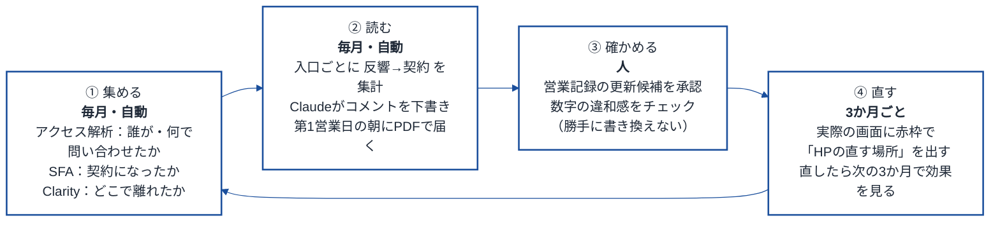
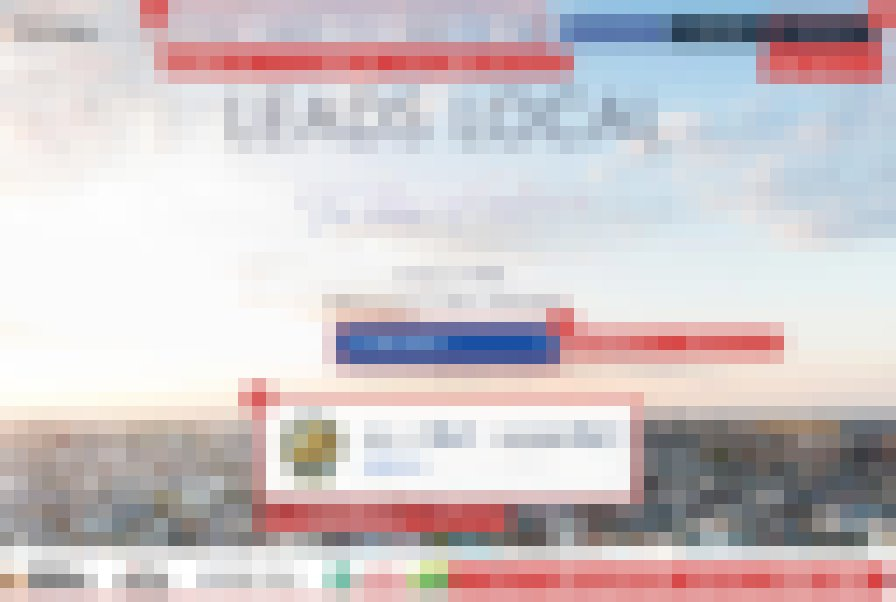
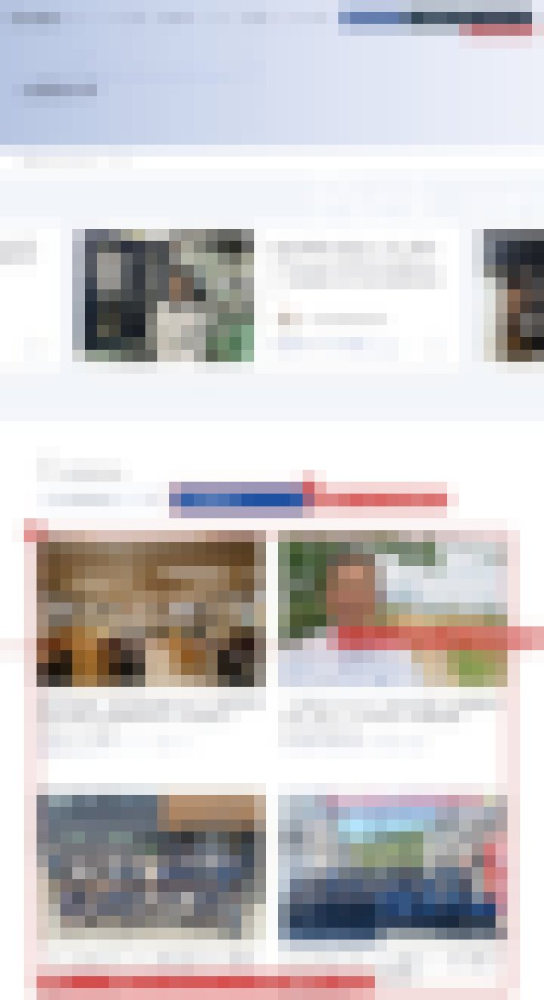
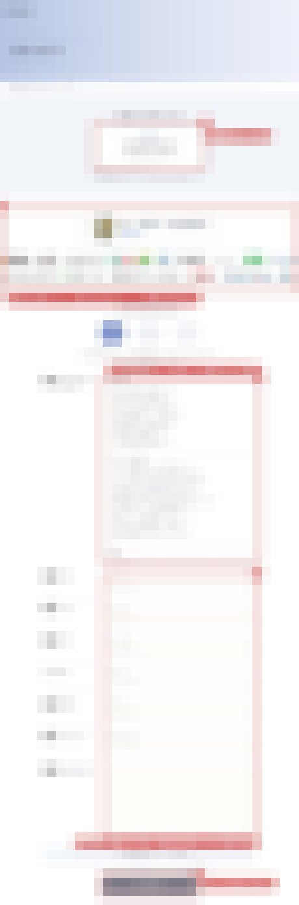
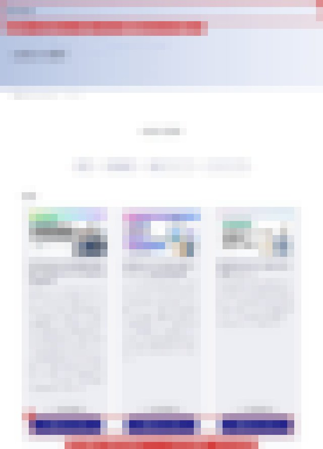

# HP自動改善ループ

**作って終わりにしない。毎月の数字で見て、3か月ごとにHPを直す — を仕組みで回す。**

アクセス解析（誰が・何で問い合わせたか）× SFA（契約になったか）× Clarity（どこで離れたか）を毎月つなぎ、Claudeがレポートを下書きし、人が確かめ、3か月ごとに「HPの直す場所」を実際の画面に赤枠で出す。
実例として、B2Bコンサルティング会社（当社）の自社サイトで回した2026年10月の結果を載せています。固有名詞・社名・個人名は伏せています。

---

## 1. ループの全体像



| ステップ | 誰が | 頻度 | 入力 | 出力 |
|---|---|---|---|---|
| ① 集める | 自動 | 毎月 | アクセス解析 / SFA / Clarity | 反響台帳（CV・経路・契約ステータス） |
| ② 読む | 自動（Claude） | 毎月 | 反響台帳 | 入口別の 反響→アポ→商談→契約 集計＋コメント下書き（PDF） |
| ③ 確かめる | 人 | 毎月 | PDF＋SFA更新候補 | 承認済みの数字（解析ツールへ反映） |
| ④ 直す | 人＋Claude | 3か月 | 承認済みの数字＋ヒートマップ | 「直す場所」赤枠つき改善案 → 実装 → 次の3か月で検証 |

**原則**
- 数字の正は「契約まで追った結果」。CV件数・CV単価だけで判断しない
- 自動で書き換えるのは下書きまで。SFA・解析ツールの更新は人が承認してから
- 直した箇所は、次の3か月の同じ指標で効果を見る

---

## 2. 結果 — 自社サイトの伸び（前年同期比）

2026年1〜9月 vs 2025年1〜9月（GA4・自社サイト）

| 指標 | 2025年 | 2026年 | 伸び |
|---|---:|---:|---:|
| サイトの訪問者（人数） | 32,262 | 86,702 | **2.69倍** |
| 自然検索からの訪問（回数） | 26,092 | 54,482 | **2.09倍** |
| フォームの送信 | 2,503 | 4,664 | **1.86倍** |
| AI検索からの訪問（回数） | 301 | 445 | **1.48倍** |

月ごとの訪問者数（GA4）

| | 1月 | 2月 | 3月 | 4月 | 5月 | 6月 | 7月 | 8月 | 9月 |
|---|---:|---:|---:|---:|---:|---:|---:|---:|---:|
| 2025年 | 3,112 | 3,955 | 4,649 | 3,645 | 2,962 | 3,033 | 4,247 | 4,016 | 4,101 |
| 2026年 | 7,551 | 6,685 | 7,645 | 6,987 | 13,097 | 9,006 | 11,847 | 14,588 | 12,684 |

訪問だけでなく「どこから来た人が契約したか」まで追っています（**Web問い合わせからの新規契約 8件・約939万円**）。

> 伸びには広告出稿（イベント集客を含む）や季節要因も含みます。フォームの送信は問い合わせ・セミナー・イベントの申込みの合計で、契約数ではありません。AI検索は ChatGPT・Gemini・Perplexity・Copilot・Claude からの訪問です。

---

## 3. 「読む」の実例 — 反響から契約まで（2025.09〜2026.10）

解析ツールの営業ステータスは9割が空欄だったため、SFAの案件約1万件と照合して23件を更新。そのうえで法人の反響352件を集計。

```
反響 352 ──10.8%──▶ アポ 38 ──71.1%──▶ 商談 27 ──66.7%──▶ 契約 18（うち新規 8）
```

落ちているのは「反響→アポ」の1か所だけ。ただし反響の58%はセミナー申込で、もともとアポを取る対象ではない。**お問い合わせに限るとアポ率30.7%**。

**どこから来た反響が契約になっているか（上位）**

| 流入経路 | 反響 | 契約 | 契約率 |
|---|---:|---:|---:|
| Google広告 | 6 | 5 | **83.3%** |
| ダイレクト | 171 | 4 | 2.3% |
| 自然検索（Google） | 45 | 2 | 4.4% |
| Meta広告 | 46 | 1 | 2.2% |
| 合計（全経路） | 352 | 18 | 5.1% |

**どの申込みが契約になっているか**

| 申込みの種類 | 反響 | 契約 | 契約率 |
|---|---:|---:|---:|
| お問い合わせ | 75 | 11 | **14.7%** |
| 資料ダウンロード | 72 | 2 | 2.8% |
| セミナー申込 | 205 | 5 | 2.4% |

**CV単価だけで見ると結論が逆になる**
- 解析ツールのAIアドバイスは「CV単価10万円は非効率なのでGoogle広告を即時停止」。契約まで追うと Google広告は反響6件で契約5件・新規4件で約674万円 — **最も契約に近い入口が止まっていた**
- 「Meta広告の再開」はCV単価約2万円が理由。だが反響46件から生まれた契約は1件
- 契約18件のうちWeb経由の新規は8件。残りは既存顧客の追加受注6・無料契約3・SFA該当なし1。「契約18」をそのまま読むと実力を倍近く見積もる

**閲覧の違い（個別診断レポート336件の中央値）**

| 到達段階 | 閲覧ページ数 | 滞在時間 | 訪問回数 |
|---|---:|---:|---:|
| 新規契約 | 13 | 10分56秒 | 3回 |
| アポ未達 | 5 | 2分44秒 | 3回 |

新規契約した会社はアポ未達の約2.6倍のページを約4倍の時間見ている。閲覧は平日9〜17時が77%、パソコンが71%。

---

## 4. 「直す」の実例 — HPの直す場所（Clarity・パソコン表示）

| # | ページ | 優先度 | 見えたこと | 直し方 |
|---|---|---|---|---|
| FIX 01 | トップ | 高 | 最初の画面で**46%が離脱**。無料相談ボタン約10回に対し「No.1の調査概要」が32回（約3倍） | 相談ボタンの下に「サービスA」「サービスB」「業種別」の3入口。文言は「30分のオンライン相談を予約する」など、押すと何が起きるか分かる言葉に |
| FIX 02 | お問い合わせ | 高 | フォームは約1,300px下から始まり到達58%、**送信ボタンまで42%**。選択肢16個で最多は「その他」。必須7項目 | フォームを電話番号の横（上部）へ。選択肢を5つ・必須を4項目に。横に日程予約 |
| FIX 03 | 支援実績 | 中 | 申込み前に最も長く読まれる（254回・2分48秒）が相談ボタンは1か所。4件目あたりで半数が離脱 | 各事例の最後に「同じ課題で相談する」。一覧4件目の後に相談の帯。業種での絞り込み |
| FIX 04 | お役立ち資料 | 中 | 申込み欄がページの70%地点、到達は半数。メニューなし。資料DLが8月以降0件 | 「ダウンロード」を押したらその場で入力欄（3項目）。メニューを揃える。計測の確認 |

<table>
<tr>
<td></td>
<td></td>
</tr>
<tr>
<td></td>
<td></td>
</tr>
</table>

---

## 5. データの穴と直し方（次回から照合なしで回すために）

| 穴 | 直し方 |
|---|---|
| アポ以降の記録がSFAにしかない（照合前は契約6件のみ） | 月1回のSFA照合を自動化、または商談担当が解析ツールのチェックも付ける |
| 社内IPからの代理登録が16件（うちセミナー14件）→ 閲覧履歴・スコアが社員のものになる | 代理登録はフォームを使わずSFAへ直接。または氏名欄に印 |
| 資料ダウンロードの反響が7月を最後に0件 | 完了ページの計測が外れていないか確認 |
| 求職者・広告費・目標・検索キーワードが未入力 | 求職者はCV種別から分離。広告費・目標・Search Console連携を入れる → AIアドバイスの前提が正しくなる |

---

## 6. 次にやること（2026年10月時点）

1. **Google広告を、お問い合わせへの検索広告として再開**（月20万円程度・主力サービスの検索語に絞る）
2. **お問い合わせフォームを上へ、項目を減らす**（契約率14.7%の入口。月2〜3件増えるだけで効く）
3. **セミナー申込のうち「新しい会社」だけを営業に回す**（照合の仕組みをそのまま使う）
4. **支援実績 → お問い合わせの導線を太くする**
5. **トップの最初の画面に相談の入口を3つ置く**

---

## 構成

```
hp-auto-improvement-loop/
├── README.md          # この1枚
└── assets/            # 「直す場所」赤枠つき画面（Clarity・パソコン幅1280px・モザイク処理済み）
    ├── fix01_top.jpg
    ├── fix02_contact.jpg
    ├── fix03_works.jpg
    └── fix04_document.jpg
```

**データ**：アクセス解析ツール 2026年10月17日取得／SFA 案件約1万件（同日）／Clarity 2026年9月19日〜10月18日（パソコン・ボット除外）／GA4 2025年1月〜2026年9月
**注記**：画面は社名・ロゴ・本文が読めないようモザイク処理しています。
